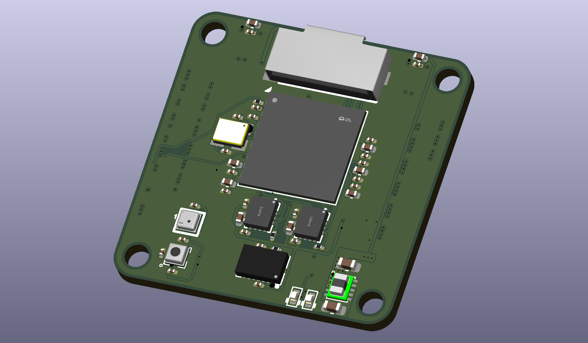
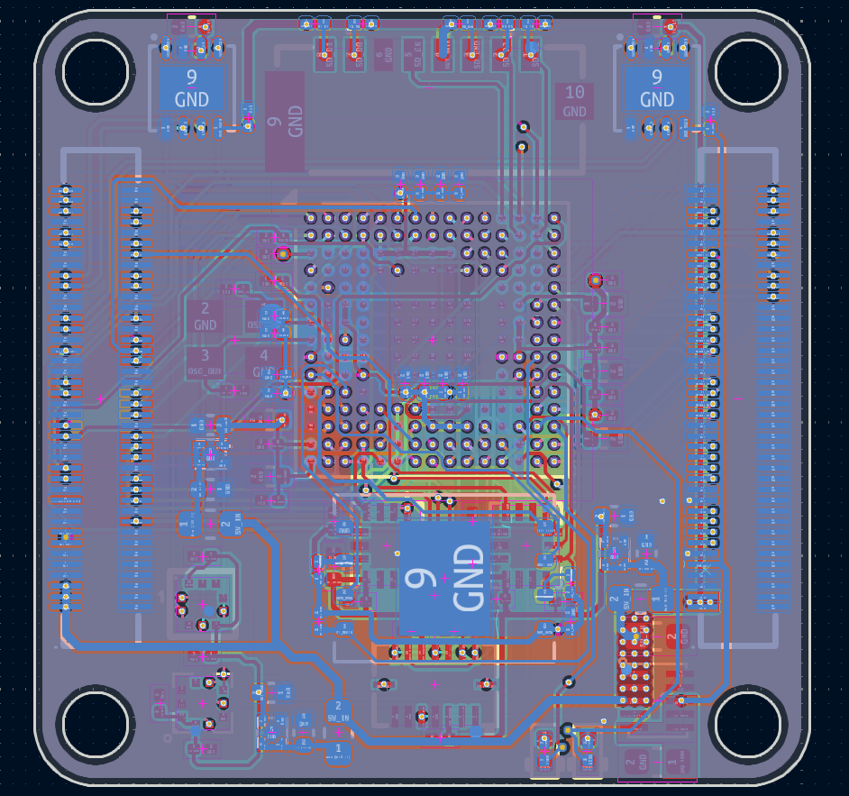
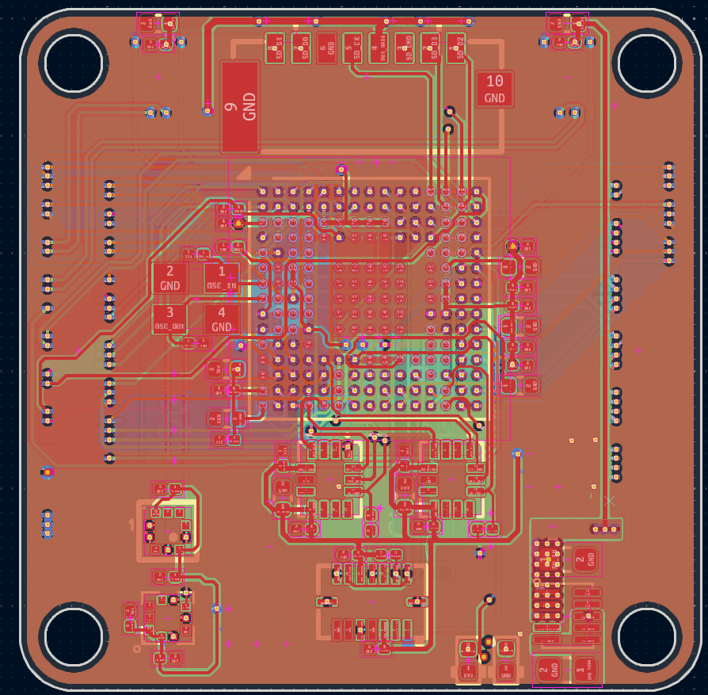

# AERIX Core

A compact STM32H7 flight controller module.

## Hardware

- STM32H743IIKx
- IIM-42653, ICM-45686, and BMI088 IMUs
- BMP390 and ICP-20100 barometers
- W25Q128JV SPI flash
- microSD card
- Two CAN transceivers
- Buck converter and three 3.3 V LDOs
- SWD and two status LEDs
- Two board-to-board connectors

This board is still being tested and is not ready for flight.

## Board views

## Bring-up

1. Open the [KiCad project](hardware/core/core.kicad_pro).
2. Run ERC and DRC.
3. Check the board for shorts.
4. Power it from a current-limited 3.3 V supply.
5. Connect `VTREF`, `GND`, `SWDIO`, `SWCLK`, and `RESET`.
6. Flash the LED test from the [firmware guide](firmware/README.md).
7. Test storage, sensors, and CAN separately.

## Files

- [Main schematic](hardware/core/core.kicad_sch)
- [MCU schematic](hardware/core/mcu.kicad_sch)
- [Sensor schematic](hardware/core/sensor.kicad_sch)
- [Power schematic](hardware/core/power.kicad_sch)
- [PCB layout](hardware/core/core.kicad_pcb)
- [Symbols, footprints, and 3D models](lib/)
- [Production files](hardware/core/production/)

## Production

- [Bill of materials](hardware/core/production/bom.csv)
- [Component positions](hardware/core/production/positions.csv)
- [Designators](hardware/core/production/designators.csv)
- [IPC netlist](hardware/core/production/netlist.ipc)

The BOM contains 25 line items and 91 parts.

| Designator | Footprint | Qty | Value | Source |
| --- | --- | ---: | --- | --- |
| C1, C2-C15, C20, C22, C24, C27, C28, C30, C31, C33-C38, C40, C41, C43, C44, C46-C48 | 0201 | 35 | 100nF | [LCSC search](https://www.lcsc.com/search?q=0201%20100nF) |
| C16-C18 | 0201 | 3 | 4.7uF | [LCSC search](https://www.lcsc.com/search?q=0201%204.7uF) |
| C19, C21, C23, C51-C56 | 0402 | 9 | 1uF | [LCSC search](https://www.lcsc.com/search?q=0402%201uF) |
| C25, C26, C29, C32 | 0402 | 4 | 2.2uF | [LCSC search](https://www.lcsc.com/search?q=0402%202.2uF) |
| C42, C45 | 0402 | 2 | 4.7uF | [LCSC search](https://www.lcsc.com/search?q=0402%204.7uF) |
| C49 | 0603 | 1 | 10uF | [LCSC search](https://www.lcsc.com/search?q=0603%2010uF) |
| C50 | 0603 | 1 | 22uF | [LCSC search](https://www.lcsc.com/search?q=0603%2022uF) |
| CARD1 | TF-SMD_TF-021B-H265 | 1 | TF-021B-H265 | [C498185](https://www.lcsc.com/product-detail/C498185.html) |
| CN1, CN2 | CONN-SMD_DF40C-80DS-0.4V-51 | 2 | DF40C-80DS-0.4V | [C312960](https://www.lcsc.com/product-detail/C312960.html) |
| FB1-FB3 | 0603 | 3 | 600R | [LCSC search](https://www.lcsc.com/search?q=0603%20600R%20ferrite%20bead) |
| LED1, LED2 | 0402 | 2 | LED | [LCSC search](https://www.lcsc.com/search?q=0402%20LED) |
| R1-R7 | 0201 | 7 | 10k | [LCSC search](https://www.lcsc.com/search?q=0201%2010k) |
| R8-R12 | 0201 | 5 | 47k | [LCSC search](https://www.lcsc.com/search?q=0201%2047k) |
| R13, R14 | 0201 | 2 | 1k | [LCSC search](https://www.lcsc.com/search?q=0201%201k) |
| U1 | UFBGA-201 | 1 | STM32H743IIKx | [LCSC search](https://www.lcsc.com/search?q=STM32H743IIKx) |
| U9, U10 | TDFN-8 | 2 | TCAN1044AVDRBRQ1 | [C3234119](https://www.lcsc.com/product-detail/C3234119.html) |
| U11-U13 | X2SON-4 | 3 | TPS7A2033PDQNR | [C2871641](https://www.lcsc.com/product-detail/C2871641.html) |
| U14 | USIP-10 | 1 | TPSM82822SILR | [C5219367](https://www.lcsc.com/product-detail/C5219367.html) |
| U2 | LGA-14 | 1 | IIM-42653 | [C30724128](https://www.lcsc.com/product-detail/C30724128.html) |
| U3 | LGA-14 | 1 | ICM-45686 | [C22459454](https://www.lcsc.com/product-detail/C22459454.html) |
| U4 | LGA-16 | 1 | BMI088 | [C194919](https://www.lcsc.com/product-detail/C194919.html) |
| U5 | LGA-10 | 1 | BMP390 | [C5124834](https://www.lcsc.com/product-detail/C5124834.html) |
| U6 | LGA-10 | 1 | ICP-20100 | [C5343527](https://www.lcsc.com/product-detail/C5343527.html) |
| U7 | WSON-8 | 1 | W25Q128JVE | [LCSC search](https://www.lcsc.com/search?q=W25Q128JVE) |
| X1 | 3.2 × 2.5 mm crystal | 1 | ABM8W-16.0000MHZ-8-D1X-T3 | [C193746](https://www.lcsc.com/product-detail/C193746.html) |
